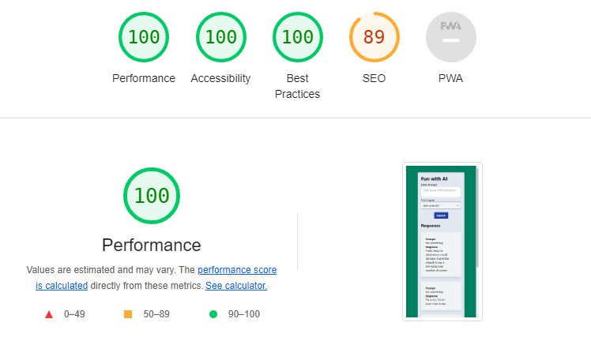

# easyWriting

Auto generate text based on the given prompt using _AI_ technology!

## Project status

This is a demo project originally built in 2022.

Dependencies were updated as of December 2025 to reduce exposure to critical bugs and security issues.

It may not work as-is today without updates, mainly because the OpenAI API surface (models/endpoints) has changed since then and browser-to-OpenAI requests are often blocked by CORS.

## Important

Local development only.

This project calls OpenAI directly from the browser, which means your API key is exposed to anyone who can load the site. Do NOT deploy this app publicly.

### Recommendation

If you want to make this project usable again, move the OpenAI call to a small server (local-only is fine) and have the React app call your server instead. This keeps your API key off the client and avoids browser CORS limitations.

## Tech Stack

### Main technologies

- TypeScript
- React
- TailwindCSS

### Build

- Vite

### Package manager

- Bun

### Formatting

- prettier

### API

- OpenAI (client-side)

### Demo

## Running application locally

Follow the following instructions to run the application locally.

1.  Get an API key from openai.com

        - Open AI offers $18 in free credits for new sign ups (no credit card required).
        - Please note free credits expire after 3 months.

2.  Then go to where you would like to store the application.

        - In a terminal run:

    `git clone https://github.com/orelbn/easyWriting`

    `cd easyWriting`

    **Make sure you have an updated version of npm and node installed.**
    - Updating npm: https://docs.npmjs.com/try-the-latest-stable-version-of-npm

3.  Install dependencies:

    `bun install`

4.  Create a local env file (do not commit this):

    `cp .env.example .env.local`

5.  Edit `.env.local` and set your key:

    `VITE_OPENAI_API_KEY="your api key"`

6.  Start the dev server:

    `bun run dev`

## Build (optional)

- `bun run build`
- `bun run preview`

7.  Press on the local host link.
    - ex. http://localhost:5173

8.  Enjoy!

### Trouble Shooting:

- If the app says your key is missing, confirm `.env.local` contains `VITE_OPENAI_API_KEY` and restart `bun run dev`.
- If OpenAI requests fail even with a key, the API endpoints/models in this demo may be outdated, and you may need to migrate to a server-side request.

## Safety banner

The app renders a warning banner at the top of the page reminding you this is local-only because it exposes an API key client-side.

## Lighthouse preformance report

